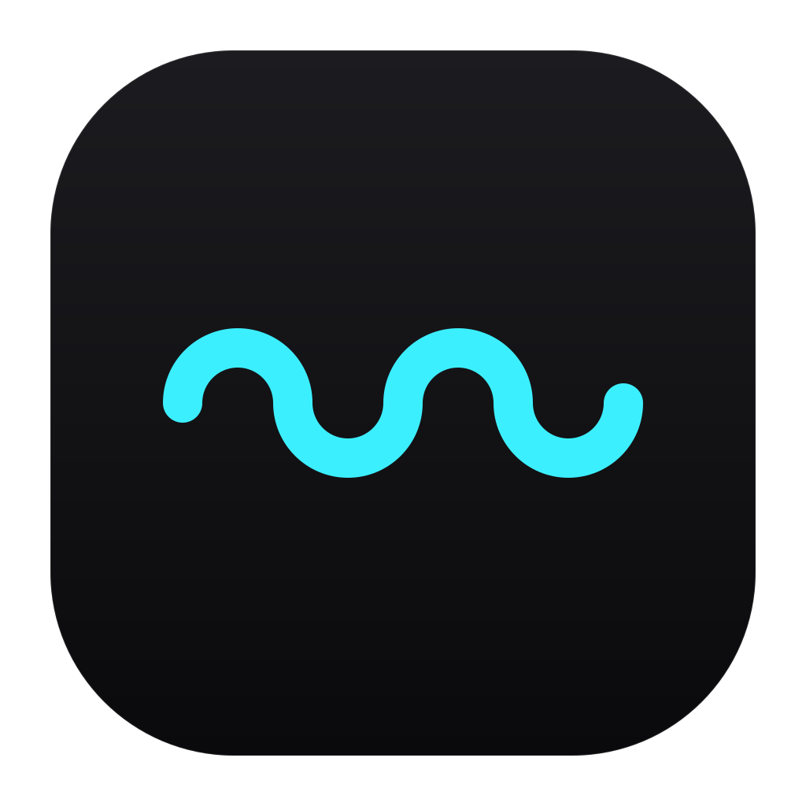
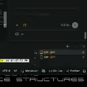
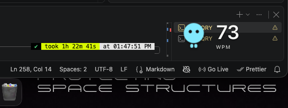
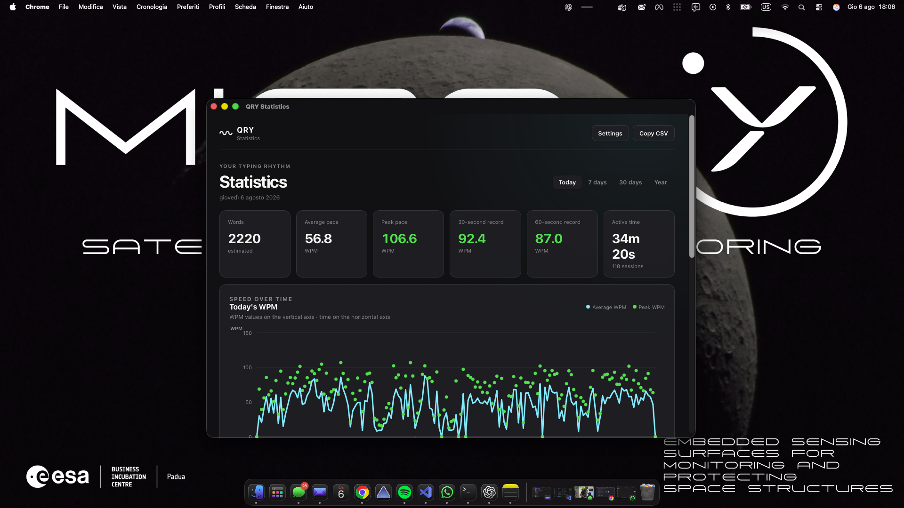
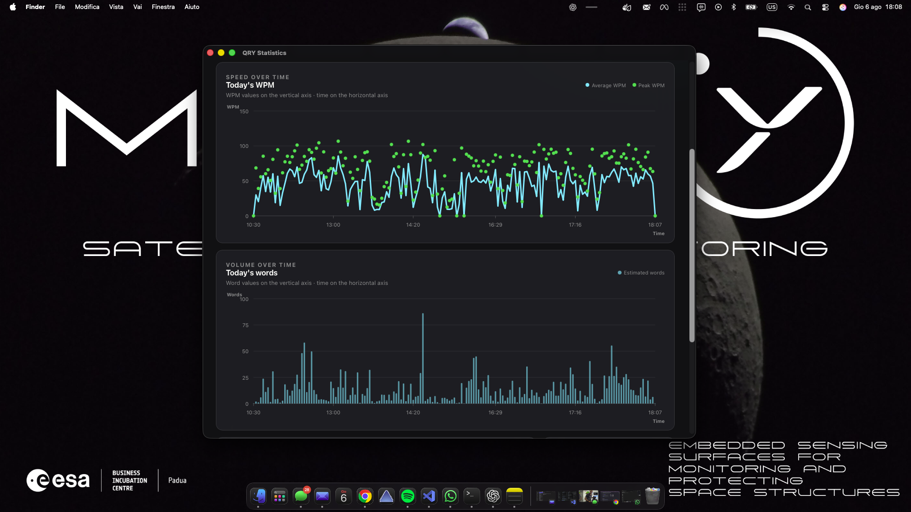
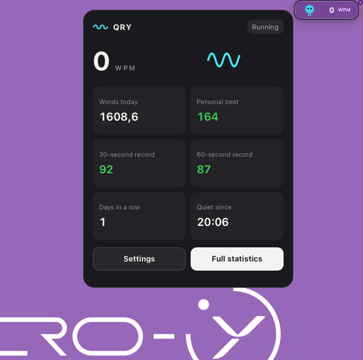
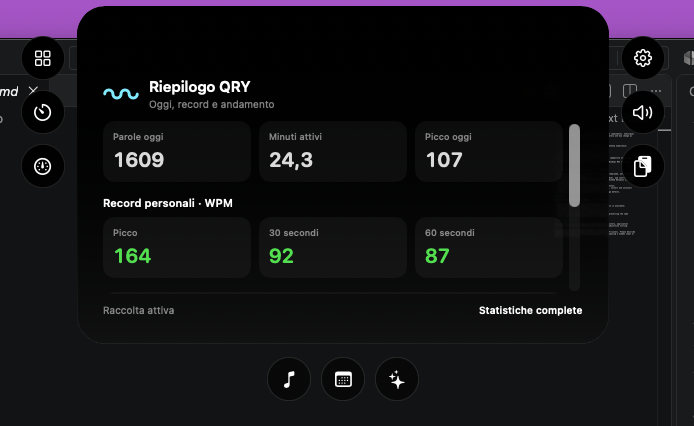

<p align="center">
  <a href="https://qry.micro-y.com">
    
  </a>
</p>

<h1 align="center">QRY</h1>

<p align="center">
  <strong>See your typing rhythm. Not what you type.</strong>
</p>

<p align="center">
  A private, local-first typing rhythm companion for macOS and Windows.<br />
  Live WPM, a responsive desktop companion, and useful statistics—without recording your words.
</p>

<p align="center">
  <a href="https://qry.micro-y.com"><strong>Website</strong></a>
  ·
  <a href="https://github.com/michele-lombardi/QRY/releases">Downloads</a>
  ·
  <a href="docs/privacy.md">Privacy</a>
  ·
  <a href="docs/development.md">Development</a>
</p>

<p align="center">
  <a href="https://github.com/michele-lombardi/QRY/actions/workflows/ci.yml"></a>
  <a href="LICENSE"></a>
  
  
</p>

<p align="center">
  
</p>

---

QRY lives quietly in the macOS menu bar or Windows tray and turns anonymous
typing activity into live feedback. Pip reacts to your pace, the shell can show
your current WPM, and private local statistics help you understand your rhythm
over time.

QRY is intentionally not a keylogger, productivity judge, or cloud analytics
service. It does not need to know which keys you press, what you write, or which
application you use.

## What QRY gives you

| Live rhythm                                                                  | Private statistics                                                           | A quiet desktop presence                                                                |
| ---------------------------------------------------------------------------- | ---------------------------------------------------------------------------- | --------------------------------------------------------------------------------------- |
| Responsive rolling WPM, animation bands, and a stable tray/menu-bar reading. | Today, 7-day, 30-day, and yearly views stored only on your computer.         | A click-through Pip overlay that stays out of the task switcher and never steals focus. |
| Peak, 30-second, and 60-second personal records with one-shot celebrations.  | Estimated words, average and peak WPM, active time, streaks, and CSV export. | Configurable corner, size, content, background, and disappearance delay.                |

### Designed to feel alive, not distracting

- Pip appears only after three accepted typing activities.
- Walk and Run respond to your current pace.
- A new peak, 30-second, or 60-second record triggers a short Jump/Cheer moment.
- When you stop typing, Pip breathes and disappears after your chosen delay.
- With optional Accessibility permission, Pip follows the display containing
  your focused window.
- System Light/Dark appearance and reduced-motion preferences are respected.

## QRY in action

<p align="center">
  <a href="img/qry-pip.png">
    
  </a>
  <br />
  <sub>Pip stays close to your work, reacts to pace, and never takes focus.</sub>
</p>

<table>
  <tr>
    <td width="50%">
      <a href="img/qry-statistics-overview.png">
        
      </a>
    </td>
    <td width="50%">
      <a href="img/qry-statistics-charts.png">
        
      </a>
    </td>
  </tr>
  <tr>
    <td align="center"><sub>Private daily records and aggregate totals</sub></td>
    <td align="center"><sub>Speed and volume shown as separate timelines</sub></td>
  </tr>
</table>

## Privacy is part of the architecture

QRY is built around a strict data boundary:

- individual keys, key codes, words, passwords, and written text are never
  persisted or logged;
- application names, window titles, visited websites, and clipboard contents are
  not collected;
- there are no accounts, telemetry, advertising identifiers, or cloud sync;
- typing activity timestamps are processed transiently and reduced to aggregate
  metrics;
- SQLite stores only session summaries, fixed metric buckets, personal records,
  and preferences;
- optional Accessibility access reads only temporary focused-window geometry for
  display placement—not its title, application, or content;
- optional local integrations share prepared aggregates only after you enable them;
- data leaves your computer only through an explicit export or another app you authorize.

The repository includes an automated privacy audit for runtime logging, Tauri
capabilities, public DTOs, and the aggregate-only SQLite schema. Read the full
[privacy model](docs/privacy.md) and [security policy](SECURITY.md).

## First-run experience

1. QRY explains what it measures and what it never collects.
2. On macOS, QRY requests required **Input Monitoring** and optional
   **Accessibility**. If required access is not granted, QRY exits instead of
   pretending to work.
3. Windows needs no equivalent consent, so QRY probes the native monitor without
   displaying a fake permission prompt.
4. You explicitly choose whether QRY should start at login. The default is off.
5. macOS performs the required clean permission restart; Windows starts in the
   same process and moves directly to the tray.

Permission revocation stops monitoring and hides the overlay immediately. QRY
returns to the same guided permission gate without deleting aggregate history.

## Platform capabilities

| Capability      | macOS                     | Windows              | Used for                                                    |
| --------------- | ------------------------- | -------------------- | ----------------------------------------------------------- |
| Global input    | Input Monitoring required | No permission prompt | Counting privacy-safe typing activities for live WPM.       |
| Focused display | Accessibility optional    | No permission prompt | Locating only the display that contains the focused window. |
| Launch at login | Optional                  | Optional             | Opening QRY silently in the tray/menu bar after sign-in.    |

QRY cannot grant or bypass system permissions. Windows does not simulate macOS
consent controls; both platforms keep launch-at-login under the user's control.

## Optional desktop integrations

On macOS 14+, **QRY Capsule** adds a native Pip and WPM indicator to the top
right of each display. Enable it in **Settings → Appearance** in a build that
includes the helper. It has no additional input permissions.

QRY can also publish an opt-in local JSON snapshot for external consumers,
including daily aggregates and speed records. The
[Vorssaint integration guide](docs/integrations/vorssaint.md) explains how to
build an adapter in **[@vorssaint/vorssaint-utils](https://github.com/vorssaint/vorssaint-utils)**.
Vorssaint code and patches are maintained outside this repository. Sharing data
does not install an upstream notch module.

See [capsule setup](docs/integrations/capsule.md) and the
[bridge protocol](docs/integrations/bridge-protocol-v1.md).

| QRY Today and Capsule                                                                              | Local Vorssaint adapter                                                                         |
| -------------------------------------------------------------------------------------------------- | ----------------------------------------------------------------------------------------------- |
|  |  |

The [integration gallery](docs/integrations/screenshots.md) includes the host's
module chooser, history chart and compact island alongside another activity.
Vorssaint images show a separate local development build.

## Project status

This branch contains QRY `0.2.0-2` development source. Active development is
integrated on `release/next`; `main` is the release baseline. Source version,
installed version and published release availability can differ. Use
[GitHub Releases](https://github.com/michele-lombardi/QRY/releases) for actual
downloads and the [changelog](CHANGELOG.md) for source changes.

The macOS and Windows application, aggregate storage, CI and release packaging
are implemented. Real-device permission, startup, sleep/wake, multi-monitor and
installer checks remain part of the release gate. The capsule requires macOS 14+;
QRY's base application targets macOS 10.15+ and Windows 10/11 x64.

## Install QRY

Download the build for your platform and its matching SHA-256 file from
[GitHub Releases](https://github.com/michele-lombardi/QRY/releases).
The [installation guide](docs/installation.md) covers checksum verification,
macOS permissions and Gatekeeper, Windows installers, updates and removal.
Current beta artifacts may use ad-hoc macOS signing or be unsigned on Windows.

The official Homebrew tap follows public stable releases, excluding drafts and
prereleases:

```bash
brew install --cask michele-lombardi/qry/qry
```

## Build from source

### Requirements

- macOS with the Apple development SDK / Xcode Command Line Tools, or Windows
  with the MSVC build tools and Windows SDK;
- Rust stable with `rustfmt` and `clippy`;
- Node.js 24 and npm.

### Run QRY locally

```bash
git clone https://github.com/michele-lombardi/QRY.git
cd QRY/QRY
npm ci
npm run tauri dev
```

macOS development builds still require explicit Input Monitoring consent. On
Windows the native monitor starts without a simulated permission prompt.

### Run the complete quality gate

From the repository root:

```bash
./scripts/check.sh
```

The gate checks frontend formatting, ESLint, TypeScript, the Vite build,
Rustfmt, Clippy, all Rust tests, Tauri capability boundaries, the SQLite schema,
privacy-sensitive DTOs, and the native capsule build/self-test on macOS.

## How it is built

```text
macOS event tap / Windows Raw Input
      │
      ▼
privacy filter ── discards key identity
      │
      ▼
TypingActivity(timestamp only)
      │
      ▼
portable Rust engine ── WPM, sessions, records, animation state
      │
      ├──► aggregate-only SQLite storage
      ├──► Tauri menu bar, Pip overlay, and statistics UI
      └──► opt-in local JSON bridge ──► capsule / external adapters
```

| Directory                                 | Purpose                                                               |
| ----------------------------------------- | --------------------------------------------------------------------- |
| [`QRY/`](QRY/README.md)                   | Tauri application, TypeScript UI, Rust workspace and manual tests.    |
| [`docs/`](docs/README.md)                 | Product, development, integration, privacy and release documentation. |
| [`integrations/`](integrations/README.md) | QRY-owned native capsule, JSON reader and Pip renderer.               |
| [`scripts/`](scripts/README.md)           | Validation, packaging and release automation.                         |
| `packaging/`                              | Public package templates, including the Homebrew cask.                |
| `img/`                                    | README screenshots and demonstrations.                                |
| `.github/`                                | CI, release workflows and contribution templates.                     |

Dependencies, generated builds, private data and external checkouts are ignored.
Public artifacts are generated under `release/` rather than committed.

Start with the [architecture guide](docs/architecture.md),
[decision log](docs/decisions/README.md), and
[development guide](docs/development.md) before changing system boundaries.

## Documentation

Start at the [documentation index](docs/README.md), or go directly to:

- [Installation](docs/installation.md) and [privacy](docs/privacy.md).
- [Development](docs/development.md) and [architecture](docs/architecture.md).
- [Capsule setup](docs/integrations/capsule.md).
- [Vorssaint integration](docs/integrations/vorssaint.md) and [bridge protocol](docs/integrations/bridge-protocol-v1.md).
- [Release process](docs/release-process.md), [roadmap](ROADMAP.md) and [changelog](CHANGELOG.md).

## Contributing

Contributions are welcome. Please read [CONTRIBUTING.md](CONTRIBUTING.md) and the
[Code of Conduct](CODE_OF_CONDUCT.md), keep changes focused, add tests, and run
`./scripts/check.sh` before opening a pull request.

Changes involving global input, permissions, logs, storage, or frontend command
boundaries must explain their privacy impact.

## Security

Please do not disclose sensitive vulnerabilities in public issues. Use
[GitHub private vulnerability reporting](https://github.com/michele-lombardi/QRY/security/advisories/new)
as described in [SECURITY.md](SECURITY.md).

## License

QRY is free software licensed under
[GNU GPL version 3 only](LICENSE) (`GPL-3.0-only`).

Copyright © 2026 Michele Lombardi. See [NOTICE.md](NOTICE.md) for attribution and
project details.

---

<p align="center">
  <a href="https://qry.micro-y.com"><strong>qry.micro-y.com</strong></a>
</p>
