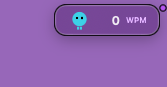

# QRY Capsule

QRY Capsule is a small native AppKit/SwiftUI companion for macOS 14 or later.
It places Pip and live WPM at the top right of each display, including external
displays. Each capsule is 104 × 30 points, inset 12 points from the right and
5 points from the top. It can sit opposite an existing workspace capsule.

This is QRY's own helper. It does not require AeroSpace, SketchyBar or a plugin
inside another Capsule application. To render QRY inside another host, implement
a consumer of the [bridge protocol](bridge-protocol-v1.md) in that host's project.



See the [full desktop example](screenshots.md#qry-today-and-the-desktop-capsule)
with the updated Today panel.

## Enable and use

1. Install a QRY build containing `QRY Capsule.app` in its `Contents/Helpers`.
2. Complete QRY's normal permission onboarding.
3. Enable **Settings → Appearance → Desktop integrations → Right-hand capsule**.

QRY launches the embedded helper when enabled and on subsequent QRY launches.
No separate login agent is needed: use QRY's own **Start at login** preference.
Only one capsule process can hold the local instance lock.

- Click the capsule to open **Today**.
- Right-click for **Statistics**, **QRY Settings** or **Close capsule**.
- Disable **Right-hand capsule** to hide it persistently.
- **Close capsule** ends the helper for the current run. QRY can launch it again
  on its next start while the preference remains enabled.

The capsule does not take keyboard focus. Pip responds to prepared motion and
celebration values and respects Reduce Motion. When QRY is stopped or its data
is stale, the capsule shows a launch action instead of a live reading. Normal
QRY exit removes the snapshot; the helper can remain available to reopen QRY.

## Build the helper

Requirements: macOS 14+, Xcode Command Line Tools with a macOS 14+ SDK, and
Node.js for reading QRY's package version. From the repository root:

```bash
./scripts/build-capsule.sh
```

The script compiles for the current architecture, signs the helper ad hoc,
verifies its signature and architecture, and runs its decoder self-test without
starting the UI. Output:

```text
build/macos-capsule/arm64/QRY Capsule.app
```

Use `./scripts/build-capsule.sh x86_64` for Intel. Cross-compilation verifies the
binary but skips execution; run its `Contents/MacOS/QRYCapsule --self-test` on
matching hardware. To preview a native build, use `open` on the generated app.

## Embed it in QRY

For a complete distributable build, run either supported release target:

```bash
./scripts/package-macos.sh aarch64-apple-darwin
# On a toolchain with the Intel Rust target:
./scripts/package-macos.sh x86_64-apple-darwin
```

The packager builds QRY, embeds the matching helper, re-signs the parent app,
verifies it and writes the ZIP/checksum under `release/`.
QRY's base application retains its existing macOS minimum; the capsule itself
requires macOS 14+ and should remain disabled on older systems.

For a debug bundle, from the repository root:

```bash
(cd QRY && npm run tauri -- build --debug --bundles app)
qry_bundle="$PWD/QRY/target/debug/bundle/macos/QRY.app"
./scripts/embed-capsule.sh "$qry_bundle"
codesign --force --sign - --preserve-metadata=entitlements "$qry_bundle"
codesign --verify --deep --strict "$qry_bundle"
```

Install the complete QRY bundle using the [installation guide](../installation.md).
Keep the helper inside the parent bundle. Replacing files inside a signed app
requires re-signing its outer resource seal. Local ad-hoc signing does not provide
Developer ID signing or notarization.

`npm run tauri dev` does not embed the helper automatically. Build/launch the
helper separately for a preview, or use the bundled debug flow above.

## Data and lifecycle

The helper reads only the bounded JSON snapshot and a sibling
`preferences-v1.json` control file. The latter contains the integration booleans
and preserves an explicit capsule opt-out even when the snapshot is absent.
External consumers must honor `externalEnabled`; enabling the capsule alone
does not authorize them to present shared metrics.

The helper's cache directory is
`~/Library/Caches/app.typepulse.desktop.capsule/`. It holds an instance lock and
`layout-v1.json`, containing only the capsule's own display geometry. It does not
contain other applications' windows or input data.

## Validate on a real desktop

Run `./scripts/check.sh` for automated checks. Before a release, also verify:

- enabled/disabled and QRY stopped/paused/permission-required states;
- a second helper launch does not duplicate panels;
- click and context-menu navigation, including cold launch and permission gating;
- multiple displays, display removal, Spaces, full screen and sleep/wake;
- Reduce Motion, light/dark appearance and readable paused/unavailable labels;
- Pip and menu-bar controls remain independent;
- the packaged helper architecture matches the main app.

Compilation and the decoder self-test do not validate these desktop interactions.
