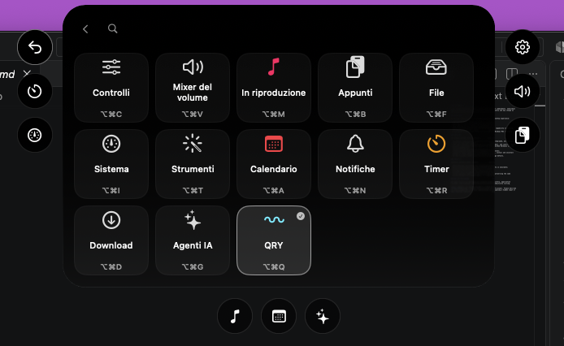
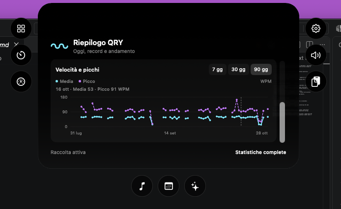
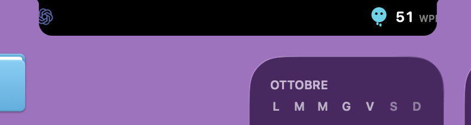

# Integration screenshots

These screenshots were supplied from a local QRY `0.2.0-2` development setup on
2026-10-28. They show QRY Capsule and a separately built Vorssaint adapter,
including the host's Italian interface. They are visual references, not a claim
that an official Vorssaint release includes QRY. Host source and patches remain
outside QRY's public repository.

## QRY Today and the desktop capsule

The updated Today panel keeps live WPM, today's estimated words, personal
records and navigation together. QRY Capsule remains visible at the top right.

The standalone capsule shows Pip and a compact WPM reading without taking focus:

Follow the [capsule guide](capsule.md) to build, embed and enable it.

## Vorssaint module and statistics

The local adapter adds a QRY destination to the host's module chooser:

The summary shows today's estimated words, active minutes and peak speed,
followed by all-time peak, 30-second and 60-second records:

The history view uses separate series for daily average speed and daily peaks.
The adapter offers 7-, 30- and 90-day ranges and inspection of individual days:

See the [Vorssaint integration guide](vorssaint.md) for the separate host work
needed to implement these surfaces against QRY's aggregate bridge.

## Compact island with another activity

On a display using the floating island, the other activity, Pip and WPM share
one compact row:

## Physical notch: reported layout regression

This capture from the MacBook's physical notch records the layout **before the
spacing correction**. With another activity on the left, Pip and WPM on the right
reach too close to the rounded edge and the unit is clipped:

A physical camera needs a clear central region. The adapter must measure the
complete content and its outer margins independently of the narrower agent-only
layout. Keep Pip on its original wing and add the companion beside it; WPM stays
on the opposite wing, with only the camera region between the groups.
Reserve the widest supported WPM reading so changing speed
does not shift the strip; do not add empty width beyond the measured content.
Verify the physical notch, the floating island and mirrored displays separately.

The correction is maintained in the separate local adapter. This original
capture documents the report; it is not an after-fix screenshot.
